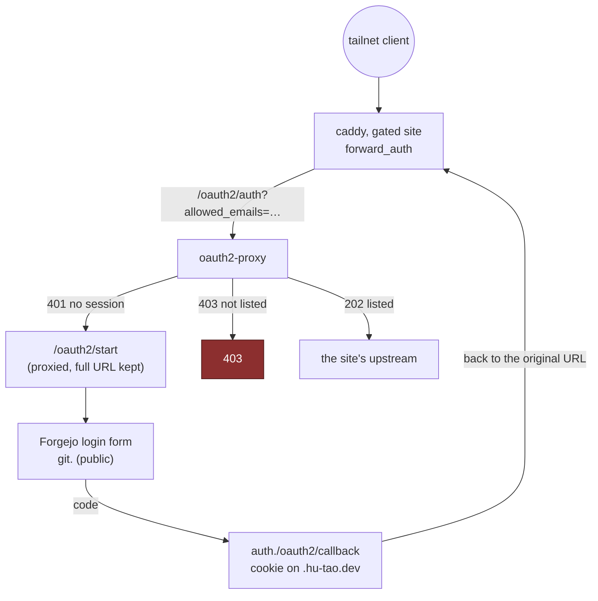

# Access control

Every service has exactly one gate, and they differ by what the service itself
supports.

| Service        | Gate                                                                                                                                               |
| -------------- | -------------------------------------------------------------------------------------------------------------------------------------------------- |
| grafana        | real login from sops; anonymous-Admin off, sign-up off                                                                                             |
| dozzle         | bcrypt hash from sops, in a `users.yml` copied to a stable path                                                                                    |
| minecraft RCON | password from sops, loopback only; one password per world (25575-25577). `minecraft-scaler` has no password: only mc-router's address reaches it   |
| serenity bot   | discord token + AI key + db password, all sops                                                                                                     |
| **kuma**       | **no seeding mechanism** — the first visitor creates the admin account and the route then closes. Create it immediately after the first deploy.    |
| syncthing      | GUI password from sops via `guiPasswordFile`, declared rather than inherited                                                                       |
| pages-hook     | HMAC of the Forgejo system webhook; the secret is in sops and must match the hook's Secret field                                                   |
| **searxng**    | **no accounts at all** — behind the shared Forgejo sign-in; only `forgejoLoginEverywhere` users, as no site list is set                            |

## Site administration is tailnet-only

Where an app's administration lives on paths its public side never uses, caddy
answers those paths with a 404 on the public listener and serves the same name
again on the tailnet listener with them open (`blockedPaths` in
`modules/containers/caddy.nix`). Tailnet devices resolve those names to the
tailnet address through
[split DNS](tailnet.md#split-dns-for-the-half-public-names), so the admin side
works from any of them with nothing configured per device.

- **kuma** — `/socket.io/` is only the admin login and dashboard; the public
  status page loads everything from `/api/status-page/*`. kuma's login is a
  message inside that socket, so no HTTP rate limit can count attempts at it:
  not exposing the socket is the only real second layer.
- **Forgejo** — `/admin` (the site admin panel) and `/api/v1/admin/*` (its
  API: users, orgs, runner tokens, cron, system webhooks). Personal and org
  settings stay public. A stolen password or session can still use what the
  account owns, but not administer the instance from outside the tailnet.
  Forgejo also routes `//admin` and `/api//v1/admin/*` to the same handlers;
  caddy's path matcher merges slashes, and a local replay confirmed those 404
  too.

The block is its own `handle`, not a bare `respond`: caddy orders `handle`
before `respond`, and the git site's upstream sits inside handle blocks for
the runner restriction, so a bare `respond` there would never run.

## Rate limiting, every site by default

Every caddy site is rate-limited unless it sets `rateLimit = null`, and none
does. It used to be opt-in, and only `search.` had opted in (for a bcrypt that
is gone now), which left the logins on `music.`, `mail.` and `git.` open to
guessing at whatever speed each app allowed — Forgejo allows any. Up to five
zones per site, all but two keyed on the client IP
(`modules/containers/caddy.nix`):

- **Site-wide** — a flood brake: 300 a minute by default; `git.` 600;
  `music.`, `grafana.` and `syncthing.` 1200. Private ranges,
  this host's public address and the CI runners are exempt, so kuma, renovate,
  pages-pull and CI are never throttled.
- **Login** — 10 POSTs a minute to the login request, with **no** exemptions:
  Roundcube `/?_task=login`, Forgejo `/user/login` (and two-factor,
  forgot-password, sign-up), Navidrome `/auth/login`. Nothing on this host
  posts to a login form, so a private source here can only be a masked client,
  and a shared bucket failing closed is the right answer.
- **Basic auth** — `git.` only: 30 a minute for requests carrying
  `Authorization: Basic`, which is how a password reaches Forgejo over git or
  the API without ever touching `/user/login`. Exempt like the site-wide zone,
  because renovate pushes with its token as a basic-auth password.
- **Downloads** — every public site: 30 a minute **in total**, keyed on a
  constant rather than the client, for `*.mrpack` and `*/releases/download/*`.
  These answer a small request with a large file, so a botnet spread thin
  enough to pass every per-IP zone could still spend the uplink on them; one
  shared bucket caps that however many addresses ask. Under attack downloads
  return 429 and nothing else is affected. Exempt like the site-wide zone.
- **Anonymous tools** — `git.` only: 120 a minute **in total** for `/api/`
  and git over https without a `token` or `Bearer` header. Anubis passes
  these unchallenged, so this is what stops a thin swarm walking commits
  through the API or asking for clone after clone. A forged token header
  gets Forgejo's 401 before any repo work, and sign-up is off, so skipping
  the bucket takes a real account. Basic auth is counted: a forged one naming
  a real user costs a password hash. Exempt like the site-wide zone.

These are one layer, not the only one. Roundcube also locks an account after 3
failures a minute; Navidrome 0.64.1 throttles failed Subsonic logins itself.
Forgejo has no throttle of its own, so
two-factor auth on the account is its second layer.

The mail protocols (465, 587, 993) never pass through caddy. Their only
brute-force control is docker-mailserver's own fail2ban: six failures in a week
buy a week's ban. Its exemption list is widened to every docker network by a
mounted `fail2ban-jail.cf`, because Roundcube's IMAP logins arrive from a
docker address — without it, six wrong webmail passwords would ban Roundcube
itself and take webmail down for everyone.

## Forgejo sign-in, for sites with no accounts

searxng has no concept of a user, so authentication is the proxy's job. Any
tailnet site can hand that job to the shared gate with one line in its caddy
site:

```nix
forgejoLogin = [ ];            # infra.forgejoLoginEverywhere only
forgejoLogin = [ "friend" ];   # ...plus friend, on this site only
```



- **One instance, one Forgejo app, one sign-in.** The session cookie is on the
  parent domain, so signing in on one gated site covers all of them. The
  Forgejo app has one redirect URI, `https://auth.<domain>/oauth2/callback`;
  gating another site needs no change in Forgejo. Sign out at
  `auth.<domain>/oauth2/sign_out`.
- **Any Forgejo account can finish the sign-in** (sign-up is closed, but the
  renovate bot is an account), so the per-site list is the actual gate. It is
  `infra.forgejoLoginEverywhere` (`modules/options.nix`, never empty) plus the
  site's own, sent as `allowed_emails`; an empty one there would admit any
  account. Usernames are public on `git.` anyway.
- **Tailnet sites only, enforced.** The check is scoped to tailnet peers so
  kuma's probe and the outsider abort still run first; on a public site that
  scope would let everyone else through. An assertion in `caddy.nix` fails the
  build instead.
- oauth2-proxy's own calls (token, keys) go to `forgejo:4242` over the proxy
  bridge. Through the public name they would hairpin into Anubis, which
  challenges a Go client.
- It replaced caddy's `basic_auth` on `search.`, whose native browser dialog is
  the one login a password-manager extension cannot fill.
- The client and cookie secrets reach oauth2-proxy as an env file, which
  docker re-reads at container start — see
  [Secrets](secrets.md#the-stale-symlink-trap).

## Anubis, every public site

Every public site asks [Anubis](https://anubis.techaro.lol/) about each
request before serving it (`modules/containers/anubis.nix`, wired in by
`forward_auth` in `modules/containers/caddy.nix`). One instance, in
subrequest mode, serves all of them. It sits **after** the site-wide rate
limit, so a flood is braked before it costs a check.

It exists because of 2026-11-07: a scraper swarm walked every commit and
`/archive/` link on `git.` from hundreds of residential addresses, a few
requests each, and Forgejo went from 2 GB to 5 GB of RAM in half an hour. A
per-IP limit cannot see a flood spread that thin. Source archives are off
since (`DISABLE_DOWNLOAD_SOURCE_ARCHIVES`), and Anubis is the general answer.

- **Challenged:** everyone, browser or not, on every web page — a
  proof-of-work page a real browser solves in under a second, then a signed
  cookie good for a week. A scraper has to run a JavaScript engine per address.
- **Passed without a challenge:** the paths real tools use, which a challenge
  would only break — `/api/`, `/v2/`, git over https (`info/refs`,
  `git-upload-pack`, `git-receive-pack`), git LFS, `/releases/download/`,
  `.rss`/`.atom` feeds, `.mrpack` modpacks and `?go-get=1` — plus Anubis's own allow-list
  (`/.well-known/`, `/robots.txt`, verified search crawlers).
- **Denied (403):** known AI crawlers and the cloud ranges in Anubis's stock
  policy (Huawei, Alibaba, …).
- **Exempt entirely:** the same addresses as the rate limit — private ranges,
  this host's public address, the CI runners.

Tailnet sites have no Anubis. `git.` and `status.` therefore never challenge a
tailnet device: split DNS sends it to their tailnet copies.

The signing key is generated at start, so restarting `docker-anubis`
re-challenges everyone once. `journalctl -u docker-anubis` shows each
challenge and each deny with the client address.

## Client addresses

Every upstream's TCP peer is caddy, so the real client address exists in one
place: **caddy's access log**, `journalctl -u docker-caddy`, one JSON line per
request on every site, Authorization and Cookie redacted. Start an audit there.

Caddy is also the only source of client-identity headers. It overwrites
`X-Forwarded-For` and strips `X-Real-IP`, `True-Client-IP` and `Remote-User`
on every site, so an upstream that trusts caddy cannot be handed an identity by
the client. Two upstreams do trust it, both for the docker range `172.16.0.0/12`.
Caddy's proxy-network address is pinned now (#43, `infra.caddyIPv4`,
172.18.0.2), so both could trust that one address instead; they have not been
narrowed yet:

- **forgejo** — `REVERSE_PROXY_TRUSTED_PROXIES`, address only.
- **webmail** — Apache `mod_remoteip`, so the access log and Roundcube's
  `REMOTE_ADDR` (its login rate limit) see the client.

**navidrome deliberately does not.** Its only trust setting,
`ExtAuth.TrustedSources`, also turns on `Remote-User` header login, and an
empty `UserHeader` is ignored. Trusting the docker range would let any
container on the proxy network log in as anyone. Its client addresses are in
caddy's log.

**Tailnet requests carry the client's tailnet address**, `100.x`. Until #43
they all read `172.18.0.1`: the firewall `redirect`ed tailnet 443 to the host's
own 8443, where docker-proxy accepted it and reconnected to caddy from the
bridge gateway. It now DNATs to caddy's pinned address instead, see
[Tailscale](network.md#tailscale). Two consequences:

- the tailnet copies of every site are **rate-limited per device**. Caddy's
  `private_ranges` exemption covers `172.16.0.0/12` but not the tailnet's
  `100.64.0.0/10`, so before #43 every tailnet request was exempt.
- webmail's `mod_remoteip` and forgejo now log and limit tailnet users by
  their `100.x` address.

A tailnet client on IPv6 still goes through docker-proxy and still reads
`172.18.0.1`, for the reason below.

**Known gap: IPv6 on the published ports.** 22, 25, 465, 587, 993 and 25565
reach their IPv4-only containers through `docker-proxy` when the client is on
IPv6, which rewrites the source to the gateway, `172.18.0.1`. Seen in
forgejo's ssh log on 2026-10-21; the same path serves DMS and Minecraft, and
DMS's fail2ban exempts the docker range, so an IPv6 client there is never
banned. Fixing it means IPv6 on the docker networks, which means recreating
them.
