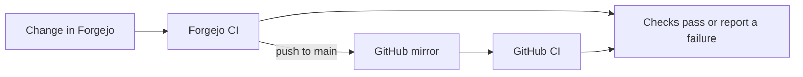

# CI

Two workflows, one per forge. **Forgejo reads `.forgejo/workflows` and falls
back to `.github/workflows` only when that directory is absent** — a fallback,
not a union — so the presence of `.forgejo/workflows/ci.yml` is what keeps
Forgejo off the GitHub file. Delete it and Forgejo silently starts running a
workflow written for GitHub, which is how this repo once ended up with a red
run on git.hu-tao.dev.

| File                           | Runs on                  | Jobs                                                           |
| ------------------------------ | ------------------------ | -------------------------------------------------------------- |
| `.forgejo/workflows/ci.yml`    | the dedicated runner box | one: `check`                                                   |
| `.forgejo/workflows/pages.yml` | the dedicated runner box | one: `pages` — builds this book, `main` only                   |
| `.forgejo/workflows/mods.yml`  | the dedicated runner box | one: `outdated` — daily, red when a mod has a newer build [^m] |
| `.github/workflows/ci.yml`     | the GitHub mirror        | two: `lint` and `evaluate`                                     |

Both CI workflows also run `packs/startup.sh`: it builds each plain `.mrpack`,
installs its exact Fabric loader and server-side mods in a temporary directory,
then waits up to five minutes for Minecraft's `Done` line. It uses the same
Java major versions as the deployed images (21 for world 2, 25 for the others)
and stops the server as soon as startup succeeds. This catches mod interactions
that the dependency checker cannot. It runs the Fabric server directly rather
than starting the itzg container; the runner intentionally gives jobs no
container-engine socket.

## What a CI run does

Forgejo is the source of truth. A push or pull request runs its CI first; pushes
to `main` are mirrored to GitHub, where the GitHub workflow runs the same checks
with a different job layout.



The checks cover different failure classes:

| Check | What it catches |
| --- | --- |
| Pre-commit hooks | Formatting, lint, generated mod lists, pack dependency and resource-pack checks |
| Full-history gitleaks | Secrets accidentally committed in repository history |
| NixOS evaluation | Invalid options, missing module arguments, and evaluation errors |
| Explicit Nix checks | Deploy schema, runner firewall ordering, runner secret isolation, and safe artifact extraction |
| Minecraft startup | Server-side Fabric or mod failures before the server reaches `Done` |

The NixOS systems are evaluated, not built or booted in CI. The Minecraft test
does boot a server process, but it uses the exact pinned server mod jars from
the pack build and a temporary flat world. It does not exercise the itzg
container's pack installation, the live server's configuration and world data,
or a client joining. Those boundaries are deliberate: CI jobs have no container
engine socket and must not be able to launch privileged sibling containers.

## Run the Minecraft startup check locally

Run all four worlds with the same command CI uses:

```sh
nix develop .#ci -c packs/startup.sh
```

To run one world, first build its pack and the matching server-mod directory,
then pass both outputs to `packs/startup.py`. Its CLI is:

```text
python3 -I packs/startup.py [-h] pack server_mods
```

`pack` is the built `.mrpack`; `server_mods` is its matching Nix output
directory. `-h` or `--help` prints this usage. The script exits nonzero if
either input is invalid, Fabric installation fails, the server exits before
`Done`, or startup exceeds five minutes.

For example, run world 4:

```sh
nix develop .#ci
pack=$(nix build --no-link --print-out-paths .#mc4-mrpack)
mods=$(nix build --no-link --print-out-paths .#mc4-server-mods)
python3 -I packs/startup.py "$pack" "$mods"
```

The first run needs network access for the pinned Modrinth jars, Fabric's
installer, and Minecraft's server files. On success, the log contains
`gemstones-lite-26.3.mrpack: server reached Done`. A failed startup exits
nonzero and includes the server log tail when it times out.

[^m]: See [Staying current](../minecraft/packs.md#staying-current).

| Check    | What                                                                                                                                                                                                                                         |
| -------- | -------------------------------------------------------------------------------------------------------------------------------------------------------------------------------------------------------------------------------------------- |
| lint     | `pre-commit run --all-files`, then gitleaks across the full history                                                                                                                                                                          |
| evaluate | evaluates all three `nixosConfigurations`, then `nix flake check --no-build`, then builds `deploy-schema` and its guard, `runner-firewall-ordering`, `runner-has-no-secrets`, `pages-pull-strips-symlinks`                                   |

**The mirror is push-only.** Commit here and let it flow across; anything
edited on GitHub is overwritten by the next sync, and CI can lag a push until
Forgejo's mirror job runs (_Synchronize Now_ in the repo's mirror settings).

## Why the two files differ

Not tidiness — each difference is forced.

- **Job layout.** The Forgejo file is one job; the mirror's is two. The runner
  keeps a nix store between runs now that it has its own box, but the `.#ci`
  shell still has to be realised, and two jobs would pay that in parallel on
  `capacity: 2`.
- **Actions, or none at all.** The Forgejo job runs on the `nix` label —
  `nixos/nix`, which already contains Nix — so there is no
  `cachix/install-nix-action` to run and no Nix to download per run. That image
  carries **no node**, and every JavaScript action is executed by a node binary
  inside the job container, so the CI file has no `uses:` whatsoever and does
  its own `git fetch` in place of `actions/checkout`.

  That is a property of **this label**, not of the runner. Since 2026-09-21
  there is also `nix-node` — nix and node in one locally built image — on which
  `uses:` works normally. These two workflows have not moved to it and do not
  need to; see [the job image](../architecture/runner.md#the-job-image-and-the-second-label)
  for when a repo should.

  `pages.yml` is the exception that proves it. It needs one action —
  `upload-artifact`, which has no shell equivalent — so it puts the dev shell's
  node on `$GITHUB_PATH` first, which is why `nodejs` is in the `ci` shell
  despite nothing here being a node project. Skipping that step fails the job
  with `crun: executable file 'node' not found in $PATH` before the action runs
  at all. `skavex` and `hutao/compress` publish the same way.

  The image is not only a saving, it is the fix: on `ubuntu-latest`
  (`node:22-bookworm`) `install-nix-action` exits 127, because the branch it
  takes without systemd runs `sudo mkdir -p /etc/nix` and that image has no
  sudo. The job is already root, so the sudo bought nothing to begin with.

`permissions:` is a GitHub-only field. Forgejo ignores it with a workflow
warning, which is why the Forgejo file omits it rather than carrying a line
that does nothing.

## System evaluation and pack startup

Both forges evaluate the NixOS system configurations rather than building
their multi-gigabyte closures. This catches what actually breaks the configs —
a typo'd option, a missing module argument, an infinite recursion — without
asking a runner to realise a whole system closure. The workflows separately
build the modpacks and boot their Fabric servers, which exercises the real
server-side mods without building or starting the NixOS hosts.

`--no-build` is load-bearing. deploy-rs's `deploy-activate` check references
the system closure, so a plain `nix flake check` builds the whole system, and
since deploy-rs `follows` our nixpkgs its binary is a cache miss and is
compiled from source.

Five checks and one package are built rather than evaluated, and each for a reason:

| Check                        | Why it must build                                                                                                                                                                                                                                                                                       |
| ---------------------------- | ------------------------------------------------------------------------------------------------------------------------------------------------------------------------------------------------------------------------------------------------------------------------------------------------------- |
| `deploy-schema`              | validates `deploy.json` against deploy-rs's schema — the config is otherwise only exercised by a real deploy. `deploy-schema-rejects-bad-input` is its guard: feed the validator a node with no `hostname` and fail if that is accepted, so a validator that silently reads nothing cannot pass forever |
| `runner-firewall-ordering`   | greps the evaluated nftables ruleset for rule order. A check that is only evaluated never runs its builder, so its failure branch would be inert                                                                                                                                                        |
| `runner-has-no-secrets`      | same reason — it catches the runner growing a `sops-install-secrets` unit, which a copy-pasted module import would do                                                                                                                                                                                   |
| `pages-pull-strips-symlinks` | asserts the symlink strip and chmod sit between unzip and copy, then runs those exact lines against a hostile zip — evaluating it would never run the builder                                                                                                                                           |
| `mc<N>-pack`                 | every hard dependency in a world's modpack, on both sides. Run by the `lint` job's pre-commit hook rather than named here; it fetches the packs' jars (~300 MB for mc3) into a job container that starts empty                                                                                          |

`runner-firewall` — the real two-node VM test with real packets — is **not** in
CI. It needs `/dev/kvm`, and these are shared-vCPU Hetzner instances with no
nested virtualisation; qemu's TCG software emulation was measured at roughly 5×
slower just to boot two minimal nodes. It stays hand-run on a machine with KVM:

```sh
nix build .#checks.x86_64-linux.runner-firewall -L
```

`minecraft-cap` is hand-run for the same reason. It boots the Minecraft
running-worlds cap and `minecraft-scaler` against three stand-in worlds:

```sh
nix build .#checks.x86_64-linux.minecraft-cap -L
```

## Writing a workflow that runs here

The runner is a different machine from the VPS, with no access to its volumes
and a six-path allow-list to its Forgejo instance. Five consequences:

1. **The label decides whether `uses:` works at all.** `nix` has no node, so a
   JavaScript action cannot execute on it — the failure is
   `crun: executable file 'node' not found in $PATH`, before the action runs.
   Pick `nix-node` for a workflow that wants `actions/checkout` or any other
   action, and pick it for **any private repo**: a hand-written `git fetch` is
   anonymous unless the author threads the job token through it, which works on
   a public repo and fails on a private one. Full list of labels and what each
   carries: [the job image](../architecture/runner.md#the-job-image-and-the-second-label).
2. **`upload-artifact` must be the Forgejo fork.** GitHub's bundles
   `@actions/artifact` v2, which decides a Forgejo instance is GitHub
   Enterprise Server and **throws before opening a socket** — zero HTTP
   requests, invisible in access logs. Use `forgejo/upload-artifact@v5`; a bare
   `uses:` resolves against `https://code.forgejo.org`, which is correct for
   it.
3. **Publishing writes an artifact, never a volume.** See [Pages](pages.md).
4. **A bare `uses:` resolves against `DEFAULT_ACTIONS_URL`** — which defaults
   to `https://data.forgejo.org`, a mirror of `actions/*` and nothing
   third-party. A third-party action must name its host, or it fails with
   `remote: Not found`. Pointing `DEFAULT_ACTIONS_URL` at github.com would fix
   it instance-wide, at the cost of making every bare `uses:` resolve to
   whoever holds that name on an open-registration forge.
5. **Of `/api/v1`, only releases.** A job can create a release and upload its
   assets (`/api/v1/repos/*/*/releases`, `…/releases/*/assets`) with its own
   token; any other API call gets `403 not permitted from a CI runner`, from
   Caddy, with no hint in Forgejo's logs. See
   [runner isolation](../architecture/runner.md#why-layer-5-exists).

Caching works normally — see
[why the cache works when artifacts did not](../architecture/runner.md#why-the-cache-works-when-artifacts-did-not).
`No cache found.` is the successful-but-empty branch, not a broken cache.

## Known gaps

- Actions are pinned by **moving tag** rather than commit SHA.
- `pages.yml` still puts the dev shell's node on `$GITHUB_PATH` before its one
  `uses:` step. Moving that job to `nix-node` would delete the step; it has not
  been done, because the same file is `skavex`'s and the two are kept identical
  deliberately.
- The `nix-node` image is rebuilt only when `flake.lock` moves, so a CVE in its
  node or curl waits for a flake bump.
- The artifact pull has no size cap (`--max-time` bounds time, not bytes).
- Job containers do not yet use `--userns=auto`.
