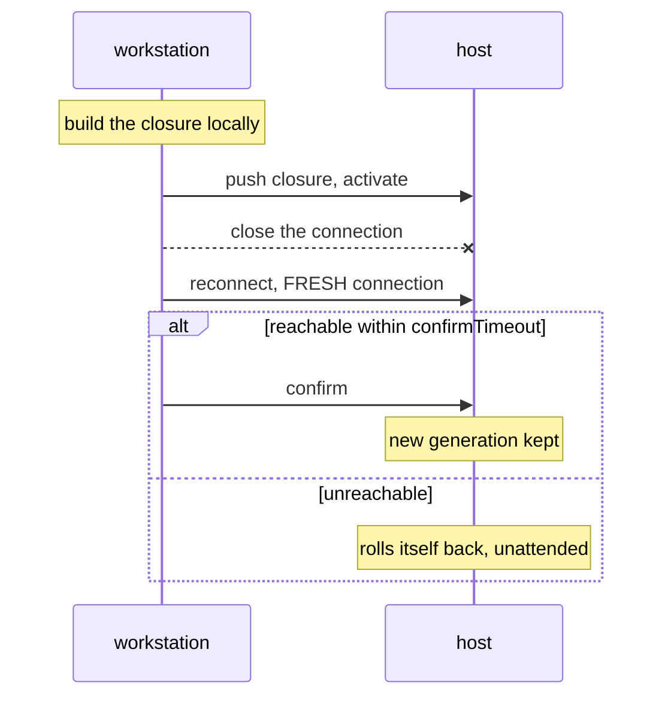

# Deploying

Two paths here, in order of how often you'll walk them: **redeploy**
(constantly) and **first deploy to an existing NixOS machine** (once per
machine). Installing onto hardware that has no NixOS at all is
[Provisioning](provisioning.md).

There are two deploy targets, and one of them is only reachable through the
other:

```sh
SOPS_AGE_KEY_FILE=/var/lib/sops-nix/vps.txt nix develop -c ssh-agent sh -c 'ssh-add ~/.ssh/id_ed25519 && deploy .#vps'
SOPS_AGE_KEY_FILE=/var/lib/sops-nix/vps.txt nix develop -c ssh-agent sh -c 'ssh-add ~/.ssh/id_ed25519 && deploy .#runner-forgejo-runner'
```

Name the node. A bare `deploy .` deploys every node, the runner first, which is
the wrong order (see below).

**Two prompts, then nothing:** the key's passphrase at `ssh-add`, then hutao's
sudo password (`interactiveSudo` in `flake.nix`; the runner logs in as root and
skips it). The agent exists only for that one command: `ssh-agent` starts it
in a private `/tmp/ssh-*` directory, runs the deploy under it and kills it on
exit, so no socket outlives the deploy. It stays on the workstation: nothing
forwards it to the box.

Without the agent, every ssh connection decrypts the key itself and a deploy
opens several, so you would type the passphrase several times.

The VPS deploy's ssh calls share one connection (`ControlMaster`, kept 20 min,
in `flake.nix`), except the rollback confirmation: the dev shell's `ssh` wrapper
sends it over a fresh one, because only a new login proves the box still lets
you in. sshd's log shows it: one `Accepted publickey` for the shared connection
and another just before `rm /tmp/deploy-rs-canary-…`.

**sudo as hutao takes hutao's password** (`modules/security.nix`), and no
agent is ever forwarded. By hand, `ssh -t` gives sudo a terminal to
ask on: `ssh -t -p 2222 hutao@vps 'sudo …'`; `scripts/rcon.sh` does the same.
A command whose output is captured or piped (`$(ssh …)`, `ssh … | openssl`,
`ssh … < file`) cannot show the prompt: run those in an interactive
`ssh -p 2222 hutao@vps` session instead, after one `sudo -v`.

---

## 1. Redeploy — the everyday path

```sh
nix flake check          # optional; deploy builds anyway
SOPS_AGE_KEY_FILE=/var/lib/sops-nix/vps.txt nix develop -c ssh-agent sh -c 'ssh-add ~/.ssh/id_ed25519 && deploy .#vps'
```

Without deploy-rs — same result, no automatic rollback:

```sh
nix develop            # provides nixos-rebuild on a non-NixOS workstation
nixos-rebuild switch --flake .#vps-hetzner --target-host hutao@vps --ask-sudo-password
```

If deploy-rs itself ever becomes unavailable, note that an unresolvable flake
input stops the flake evaluating **at all** — so that fallback needs the input
removed from `flake.nix` first, not just a different command.

That is the whole thing. `deploy-rs` builds locally, pushes the closure,
activates it, then **waits for a fresh connection to confirm the box is still
reachable**. If it cannot reconnect, the machine rolls itself back to the
previous generation without being asked.

What it protects and what it does not:

| Failure                                           | Caught by                                |
| ------------------------------------------------- | ---------------------------------------- |
| firewall / sshd / networking change locks you out | **deploy-rs auto-rollback**              |
| unbootable kernel or initrd                       | GRUB generation menu, 5s timeout at boot |
| a container fails to start                        | _not_ auto-rolled back — see below       |

The last row is deliberate. deploy-rs confirms reachability, not service health.
A crashlooping container is visible and you still have ssh, so:

```sh
ssh -p 2222 hutao@vps 'systemctl --failed; systemctl status docker-<name>'
ssh -t -p 2222 hutao@vps 'sudo nixos-rebuild switch --rollback'
```

Rolling the whole system back because one container is unhappy is usually the
wrong reflex — fix it forward.



`confirmTimeout` is 120 s — long enough for every container to be recreated on
a config change, short enough that a hung activation is not an outage. The
activation timeout is 900 s, raised from 300 s for the serenity-bot image
build, which runs **in the activation script** while the old container is still
serving; `serenity-bot-image.service` is only the boot-time fallback. Measured on
this host on 2026-09-04, cold cache including the base image pulls: 3m28s.

### The runner is deployed through the VPS

The runner is deliberately off the tailnet, and inbound ssh is narrowed to the
VPS `/32` at **both** layers — its cloud firewall and its own nftables — so the
only route in is a jump:

```sh
deploy .#runner-forgejo-runner    # sshOpts carry ProxyJump=hutao@vps:2222
ssh -J hutao@vps:2222 root@46.225.61.172     # by hand
```

Magic rollback matters more here than anywhere: a mistake in
`modules/runner/firewall.nix` locks out the only path to the box, and the jump
host cannot help with that. Deploy the **VPS first and the runner last** when a
change touches both — the runner's route in is defined by the VPS's outbound
rules, so a VPS deploy that has not landed yet means a runner you cannot
reach.

**The jump hop goes to 2222.** `ProxyJump=hutao@vps:2222` names the port on
purpose: a bare `vps` lands on 22, which on the tailnet used to be Tailscale SSH
and is forgejo's now that Tailscale SSH is off. Both deploys use the VPS's own
sshd with an ordinary key, which is why 2222 is listed in the policy and called
deploy-critical there.

### Ports and names, so nothing surprises you

- `vps` is the **tailnet node name**, which is why `deploy.nodes.vps.hostname` is
  a name and not an address. It is not `networking.hostName` (`hu-tao`):
  renaming the node in the Tailscale console breaks deploys. It survives the
  primary-IP handover during a migration, so the same command works before and
  after cutover.
- ssh is on **2222**. Port 22 belongs to forgejo, so that git clone URLs need no
  port. Tailscale SSH is off, so 2222 with a normal key is the only ssh in,
  and only over the tailnet: publicly, 2222 is the tarpit.

### If a deploy fails with "lacks a signature by a trusted key"

`nix.settings.trusted-users` must include `@wheel` (it does, in
`modules/nix.nix`). If you ever deploy to a machine that predates that setting,
you cannot push to it — build on the box instead:

```sh
rsync -a --delete --exclude .git -e 'ssh -p 2222' ./ hutao@vps:nixos-image/
ssh -t -p 2222 hutao@vps 'cd nixos-image && sudo nixos-rebuild switch --flake .#vps-hetzner'
```

That is also the bootstrap for the very first deploy after an install.

---

## 2. First deploy to a machine that already runs NixOS

Same as a redeploy, with two one-time steps:

```sh
# 1. Trust the host key, or deploy-rs fails with "Host key verification failed"
#    and no way to answer the prompt.
ssh-keyscan -p 2222 -H hu-tao >> ~/.ssh/known_hosts

# 2. Confirm the box can decrypt its own secrets before relying on it.
ssh -t -p 2222 hutao@vps 'sudo ls /run/secrets/ | wc -l'   # expect 31
```

31 is 30 secrets plus the `rendered/` directory; the root and user password
hashes live in `/run/secrets-for-users`. Recompute it when a module adds a key:

```sh
nix eval --json .#nixosConfigurations.vps-hetzner.config.sops.secrets \
  --apply 's: builtins.length (builtins.filter (v: !v.neededForUsers) (builtins.attrValues s)) + 1'
```

Then `deploy .#vps`.

---

## Recreating the proxy network (#43)

A one-time step, done **before** the first deploy that pins the `proxy`
network's subnet. `docker-network-proxy.service` only creates a network that is
missing. It never changes an existing one, so the subnet, gateway and
`--ip-range` from `infra.proxySubnet` / `proxyGateway` / `proxyIpRange` land
only when the network is created again. On a fresh machine there is nothing to
do.

**Do it before the deploy, not after.** The new caddy unit passes
`--ip=172.18.0.2`, and docker refuses `--ip` on a network created without
`--subnet`. Deploying first leaves caddy failing to start, the public sites
down with it, and deploy-rs aborting on the failed unit (see
[the abort that was worse than the failure](recovery.md#the-abort-that-was-worse-than-the-failure)).
Done in this order, the old generation's containers start on the new network
with addresses from the dynamic range, and the deploy only recreates caddy.

Outage: every container on `proxy`, mail included, for about a minute. Senders
retry SMTP.

```sh
# 1. On the workstation, from the branch being deployed: the network unit's
#    own script, so the create arguments come from the repo, not from typing.
nix eval --raw .#nixosConfigurations.vps-hetzner.config.systemd.services.docker-network-proxy.script \
  > /tmp/create-proxy.sh
cat /tmp/create-proxy.sh     # want: --subnet=172.18.0.0/16 --gateway=172.18.0.1 --ip-range=172.18.128.0/17

# 2. On the box: the units on the network, read from docker rather than a list.
units=$(ssh -t -p 2222 hutao@vps \
  "sudo docker network inspect proxy --format '{{range .Containers}}docker-{{.Name}} {{end}}'")
echo "$units"

# 3. Stop them, remove the network, create it from the script, start them again.
ssh -t -p 2222 hutao@vps "sudo systemctl stop $units && sudo docker network rm proxy"
ssh -t -p 2222 hutao@vps 'sudo bash -s' < /tmp/create-proxy.sh
ssh -t -p 2222 hutao@vps "sudo docker network inspect proxy --format '{{json .IPAM.Config}}' \
  && sudo systemctl start $units"

# 4. Deploy as usual. caddy is recreated at 172.18.0.2 and nftables switches
#    tailnet 80/443 from redirect to DNAT.
deploy .#vps
```

`systemctl stop` removes each container (oci-containers runs them with
`--rm`), which is what lets `docker network rm` succeed. If it still reports
active endpoints, `sudo docker network inspect proxy` names what is left.

Then check that it did what it was for:

```sh
ssh -t -p 2222 hutao@vps "sudo docker inspect caddy --format '{{range .NetworkSettings.Networks}}{{.IPAddress}}{{end}}'"
# want: 172.18.0.2

# From a tailnet device, then read caddy's log for that request:
curl -sS -o /dev/null -w '%{http_code}\n' https://grafana.hu-tao.dev/
ssh -p 2222 hutao@vps 'journalctl -u docker-caddy -n 50 -o cat | grep grafana | tail -1'
# want: "remote_ip":"100.x.y.z", the device's tailnet address, not 172.18.0.1

# HTTP/3 now takes the forwarded path that udp 8443 direct never got through
# (see the known quirk in architecture/network.md). Needs a curl built with HTTP/3:
curl -sS --http3-only -o /dev/null -w '%{http_code} %{http_version}\n' https://grafana.hu-tao.dev/
# want: a status code and 3. A timeout means tailnet HTTP/3 is broken; browsers
# fall back to TCP, but the udp rule should go back to `redirect` until it is fixed.
```

Kuma's tailnet monitors should stay green throughout the deploy. Kuma reaches
`https://<name>:8443` from the proxy bridge, so it arrives on the input hook
and never passes through the tailscale0 rules.

---

## What makes this automatic (and what used to break it)

Every item below is now in the config. They are listed because each one, when
missing, produces a machine that installs with no error and then does not work —
the worst failure shape there is.

| Setting                                                 | Where                  | Without it                                                                                                                                                                         |
| ------------------------------------------------------- | ---------------------- | ---------------------------------------------------------------------------------------------------------------------------------------------------------------------------------- |
| `boot.initrd.availableKernelModules` with **virtio**    | `modules/hardware.nix` | NixOS's default set is bare-metal only. The initrd cannot see `/dev/sda`, root never mounts, and the box sits in an emergency shell while the provider still reports it `running`. |
| **GRUB**, not systemd-boot                              | `modules/boot.nix`     | Hetzner Cloud boots legacy BIOS — there is no `/sys/firmware/efi`. systemd-boot installs cleanly and leaves an unbootable machine.                                                 |
| `efiInstallAsRemovable`, `canTouchEfiVariables = false` | `modules/boot.nix`     | There is no efivarfs in BIOS mode; bootloader installation fails outright if it tries to write NVRAM.                                                                              |
| `time.timeZone`                                         | `modules/boot.nix`     | Unset means NixOS does not manage `/etc/localtime`, so docker creates a _directory_ there and every container that bind-mounts it dies with "not a directory".                     |
| `nix.settings.trusted-users = @wheel`                   | `modules/nix.nix`      | `deploy-rs` cannot push: "lacks a signature by a trusted key".                                                                                                                     |
| ssh on **2222**                                         | `modules/services.nix` | Port 22 is forgejo's. Also needs a matching rule in the **Hetzner edge firewall**, which is separate from the host's nftables.                                                     |
| `interactiveSudo` on `deploy.nodes.vps`                 | `flake.nix`            | sudo asks for a password nobody can type. Activation fails and the box rolls back.                                                                                                 |

**The VM test cannot catch any of these.** `nixos-anywhere --flake .#vps
--vm-test` validates disko, GRUB and that the system boots — genuinely useful,
and it is what proved GRUB-on-BIOS works. But the NixOS test harness injects its
own virtio modules and its own networking, so a config that boots in the test can
still be unbootable on real hardware. Treat a passing VM test as "the layout and
bootloader are sane", never as "this will boot on the server".

---

## Verifying a machine is actually healthy

Not "the deploy said success" — these:

```sh
ssh -t -p 2222 hutao@vps '
  systemctl is-system-running          # want: running
  systemctl --failed                   # want: empty
  sudo ls /run/secrets | wc -l         # want: 31
  sudo docker ps --format "{{.Names}} {{.Status}}"
  for u in caddy forgejo mailserver webmail kuma navidrome searxng pages-hook mc-router \
           grafana tempo dozzle cloudflared serenity-bot-0 serenity-redis; do
    echo "$u restarts=$(systemctl show -p NRestarts --value docker-$u)"
  done
  systemctl is-active postgresql pgbouncer serenity-bot-image minecraft-scaler'
```

Non-zero `NRestarts` means a crashloop that `systemctl is-active` will happily
report as `active`, because systemd restarts it fast enough to look healthy.

And confirm the certificate is real rather than the self-signed placeholder that
`security.acme` installs when issuance fails — services start either way, so
nothing looks wrong until you check the issuer:

```sh
ssh -t -p 2222 hutao@vps 'sudo cat /var/lib/acme/hu-tao.dev/cert.pem' \
  | openssl x509 -noout -issuer -enddate
# want: issuer=C=US, O=Let's Encrypt, ...
# bad:  issuer=CN=minica root ca ...   <- placeholder, DNS-01 failed
```

Before triggering ACME, test the Cloudflare token directly — Let's Encrypt caps
failed validations at 5 per hour and lego spends one per attempt:

```sh
ssh -t -p 2222 hutao@vps 'sudo bash -c "
  T=\$(cat /run/secrets/cloudflare_api_token)
  curl -sS -H \"Authorization: Bearer \$T\" \
    https://api.cloudflare.com/client/v4/zones?name=hu-tao.dev"'
```

An empty `result` array with `success: true` means the token cannot see the zone
— which reads as success if you only check `.success`.

## If deploy-rs ever disappears from GitHub

The risk is bigger than losing `deploy`: flake inputs are fetched from source,
not from the binary cache, so an unresolvable input means **the flake stops
evaluating entirely** and `nixos-rebuild --flake` fails too.

Three mitigations, in order of effort:

1. **Nothing breaks while the store path is present.** A locked input already
   realised in `/nix/store` is not refetched. `nix flake archive` copies every
   input into the store on purpose, and `nix-store --gc` is what would remove
   them again.
2. **Keep a copy**: `nix flake archive --to file:///path/to/mirror` writes all
   inputs somewhere you control.
3. **Cut it out** — a three-part edit to `flake.nix`, after which option 2 above
   is the only deploy path:
   - delete the `deploy-rs` entry from `inputs`
   - delete `deploy-rs` from the `outputs = { ... }` argument list
   - delete the `deploy` and `checks` outputs, and `deploy-rs.packages.${system}.default`
     from the devShell

   Nothing in `modules/` references it, so the machine configuration itself is
   unaffected.
